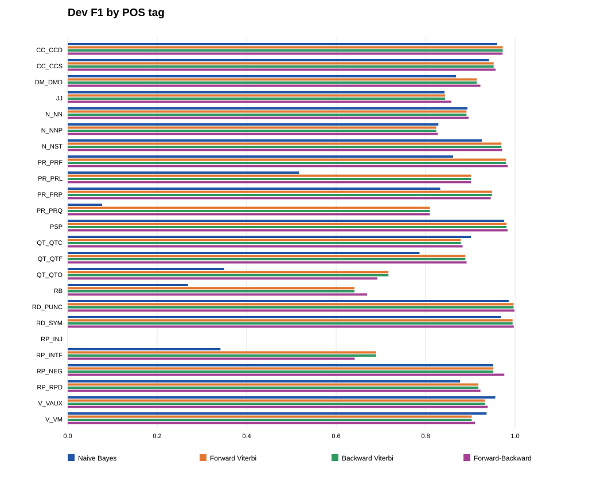
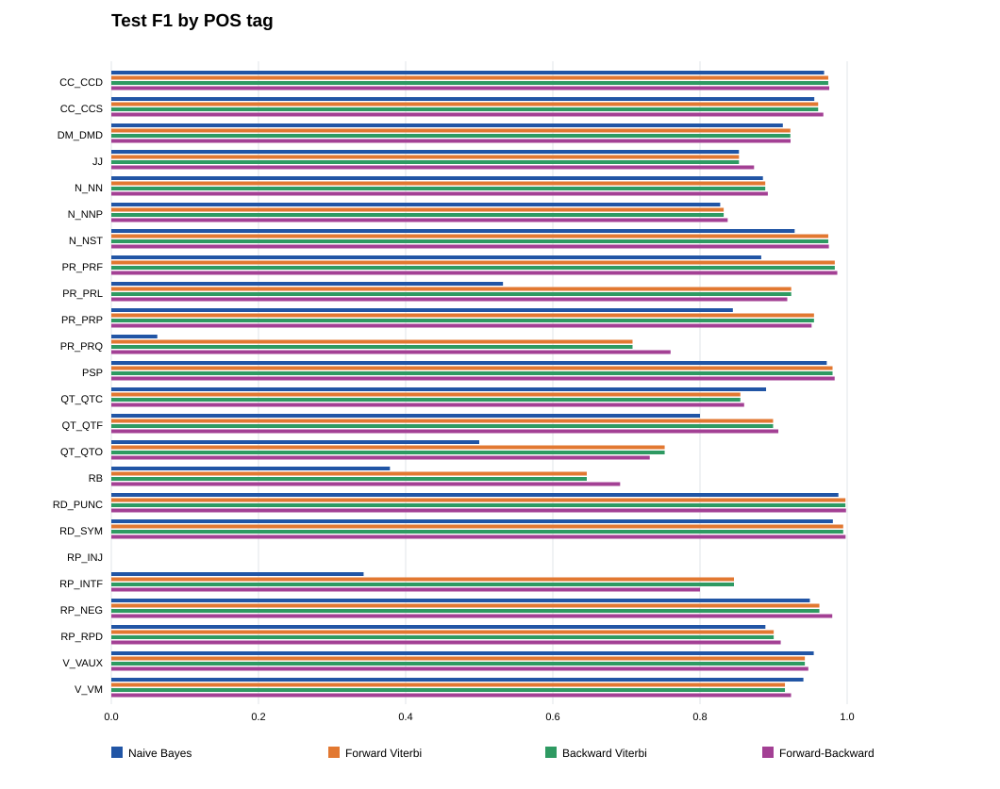

# Lab Assignment 7: Hindi POS tagging

## Method

- Training uses only `hindi-train-pos.txt`. Dev and test are evaluated independently; neither is used to estimate probabilities.
- Naive Bayes uses the five specified features: binary word length (>4), current word, previous word, next word, and previous tag. During inference, the previous tag is the model's preceding prediction. All categorical likelihoods and tag priors use add-one smoothing.
- The HMM uses tag bigrams, sentence start/end probabilities, and word emission probabilities. Words seen only once in training are grouped as `<UNK>` so unseen words have an estimated emission distribution. All HMM counts use add-one smoothing.
- Forward Viterbi finds the highest-probability sequence left to right. Backward Viterbi uses reverse tag transitions and decodes right to left. Forward-Backward computes forward/backward probabilities and chooses the highest-posterior tag at each position (posterior decoding).
- F1 is calculated independently for every tag; a tag with no predictions has F1 = 0. Macro F1 averages all training tags. Accuracy is correct tokens divided by all tokens.

## Dev (1,866 sentences, 40,762 tokens)

| Algorithm | Accuracy | Macro F1 |
|---|---:|---:|
| Naive Bayes | 0.9102 | 0.7436 |
| Forward Viterbi | 0.9153 | 0.8541 |
| Backward Viterbi | 0.9153 | 0.8541 |
| Forward-Backward | 0.9199 | 0.8561 |

| Tag | Support | Naive Bayes | Forward Viterbi | Backward Viterbi | Forward-Backward |
|---|---:|---:|---:|---:|---:|
| CC_CCD | 829 | 0.9598 | 0.9725 | 0.9725 | 0.9720 |
| CC_CCS | 752 | 0.9415 | 0.9521 | 0.9521 | 0.9564 |
| DM_DMD | 499 | 0.8682 | 0.9142 | 0.9142 | 0.9225 |
| JJ | 2370 | 0.8422 | 0.8435 | 0.8435 | 0.8572 |
| N_NN | 9098 | 0.8934 | 0.8915 | 0.8915 | 0.8960 |
| N_NNP | 4853 | 0.8286 | 0.8239 | 0.8239 | 0.8269 |
| N_NST | 621 | 0.9258 | 0.9696 | 0.9696 | 0.9712 |
| PR_PRF | 152 | 0.8614 | 0.9799 | 0.9799 | 0.9833 |
| PR_PRL | 106 | 0.5170 | 0.9016 | 0.9016 | 0.9016 |
| PR_PRP | 1428 | 0.8327 | 0.9485 | 0.9485 | 0.9456 |
| PR_PRQ | 25 | 0.0769 | 0.8095 | 0.8095 | 0.8095 |
| PSP | 8023 | 0.9758 | 0.9809 | 0.9809 | 0.9833 |
| QT_QTC | 856 | 0.9015 | 0.8787 | 0.8787 | 0.8827 |
| QT_QTF | 330 | 0.7865 | 0.8889 | 0.8889 | 0.8917 |
| QT_QTO | 66 | 0.3500 | 0.7170 | 0.7170 | 0.6923 |
| RB | 161 | 0.2688 | 0.6409 | 0.6409 | 0.6692 |
| RD_PUNC | 2487 | 0.9858 | 0.9968 | 0.9968 | 0.9986 |
| RD_SYM | 361 | 0.9683 | 0.9944 | 0.9944 | 0.9972 |
| RP_INJ | 1 | 0.0000 | 0.0000 | 0.0000 | 0.0000 |
| RP_INTF | 34 | 0.3415 | 0.6897 | 0.6897 | 0.6415 |
| RP_NEG | 266 | 0.9513 | 0.9514 | 0.9514 | 0.9760 |
| RP_RPD | 647 | 0.8771 | 0.9181 | 0.9181 | 0.9226 |
| V_VAUX | 2544 | 0.9557 | 0.9326 | 0.9326 | 0.9387 |
| V_VM | 4253 | 0.9364 | 0.9030 | 0.9030 | 0.9102 |

Highest macro F1: **Forward-Backward** (0.8561).

## Test (1,910 sentences, 41,415 tokens)

| Algorithm | Accuracy | Macro F1 |
|---|---:|---:|
| Naive Bayes | 0.9104 | 0.7600 |
| Forward Viterbi | 0.9176 | 0.8611 |
| Backward Viterbi | 0.9176 | 0.8611 |
| Forward-Backward | 0.9227 | 0.8663 |

| Tag | Support | Naive Bayes | Forward Viterbi | Backward Viterbi | Forward-Backward |
|---|---:|---:|---:|---:|---:|
| CC_CCD | 772 | 0.9687 | 0.9743 | 0.9743 | 0.9756 |
| CC_CCS | 736 | 0.9553 | 0.9606 | 0.9606 | 0.9676 |
| DM_DMD | 516 | 0.9126 | 0.9228 | 0.9228 | 0.9231 |
| JJ | 2258 | 0.8529 | 0.8530 | 0.8530 | 0.8735 |
| N_NN | 9303 | 0.8855 | 0.8887 | 0.8887 | 0.8922 |
| N_NNP | 5296 | 0.8274 | 0.8322 | 0.8322 | 0.8376 |
| N_NST | 625 | 0.9286 | 0.9743 | 0.9743 | 0.9751 |
| PR_PRF | 151 | 0.8832 | 0.9832 | 0.9832 | 0.9866 |
| PR_PRL | 91 | 0.5323 | 0.9240 | 0.9240 | 0.9186 |
| PR_PRP | 1338 | 0.8447 | 0.9549 | 0.9549 | 0.9517 |
| PR_PRQ | 31 | 0.0625 | 0.7083 | 0.7083 | 0.7600 |
| PSP | 8245 | 0.9723 | 0.9801 | 0.9801 | 0.9830 |
| QT_QTC | 874 | 0.8898 | 0.8548 | 0.8548 | 0.8600 |
| QT_QTF | 323 | 0.8000 | 0.8994 | 0.8994 | 0.9065 |
| QT_QTO | 78 | 0.5000 | 0.7520 | 0.7520 | 0.7317 |
| RB | 167 | 0.3786 | 0.6462 | 0.6462 | 0.6914 |
| RD_PUNC | 2549 | 0.9881 | 0.9976 | 0.9976 | 0.9984 |
| RD_SYM | 464 | 0.9806 | 0.9946 | 0.9946 | 0.9978 |
| RP_INJ | 1 | 0.0000 | 0.0000 | 0.0000 | 0.0000 |
| RP_INTF | 29 | 0.3429 | 0.8462 | 0.8462 | 0.8000 |
| RP_NEG | 243 | 0.9493 | 0.9622 | 0.9622 | 0.9798 |
| RP_RPD | 617 | 0.8889 | 0.9002 | 0.9002 | 0.9097 |
| V_VAUX | 2534 | 0.9546 | 0.9425 | 0.9425 | 0.9472 |
| V_VM | 4174 | 0.9405 | 0.9154 | 0.9154 | 0.9238 |

Highest macro F1: **Forward-Backward** (0.8663).

